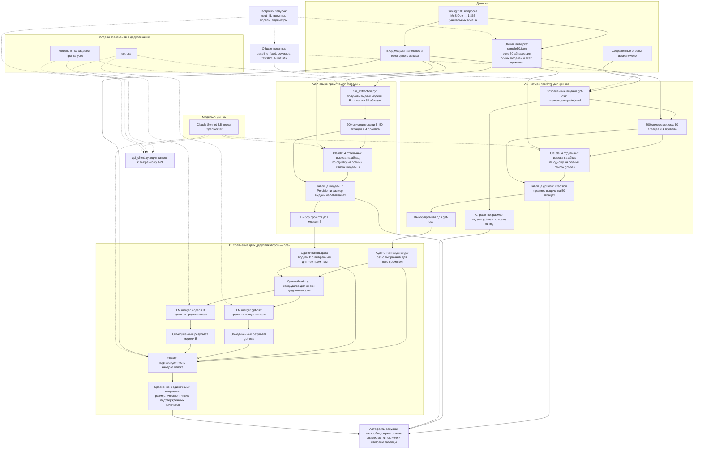

# Wikontic — схема эксперимента

Сплошные стрелки показывают поток данных, пунктир — настройки и выбор модели. Сначала сравниваем четыре промпта **внутри каждой модели** на одних и тех же 50 абзацах. Результат — отдельный выбор для gpt-oss и для второй модели института (модель B), а не перенос одного промпта с одной модели на другую.

**Сравнение промптов:** используем [одни и те же 50 абзацев](../runs/prompt_comparison/sample50.json) и четыре одинаковых промпта для обеих моделей извлечения. На абзац приходится четыре отдельных списка gpt-oss и четыре модели B. Claude получает исходный абзац и один полный список за запрос. Он не видит название промпта, модель извлечения и другие списки. Длинные списки не дробим, метки между списками не переносим. Сырые ответы и ошибки сохраняем; пропущенная метка не равна `0`.

**Что уже есть:** для gpt-oss готовы [200 списков с 2 266 триплетами](../runs/prompt_comparison/answers_complete.jsonl). Qwen3-235B сейчас недоступен, модель B не определена. Сохранённые [ответы Qwen](../data/answers/qwen_paragraph.jsonl) не пересекаются с `sample50.json` и не заменяют новую выдачу. Строки со статусом `ok` в файлах извлечения — кандидаты, а не метки Claude.

**Основные таблицы:** для каждой модели отдельно считаем Precision и размер выдачи (всего триплетов и в среднем на абзац) на тех же 50 абзацах. Выбранные промпты могут совпасть или различаться. Если различия не позволяют уверенно выбрать победителя, так и фиксируем. Размер выдачи gpt-oss на всех 1 863 абзацах — справочно, не вместо показателя на выборке. Размер выдачи сам по себе не измеряет полноту.

**Следующий этап:** [`run_dedup.py`](../scripts/run_dedup.py) передаёт объединённый пул обеим моделям института по отдельности, в том же порядке и с одним промптом. Каждая модель возвращает группы с представителями. Код проверяет, что каждый входной ID входит ровно в одну группу и что представитель — её участник. В итог идут исходные представители без переписывания. Если у моделей разные промпты, одиночные выдачи сравниваются как конфигурации «модель + промпт», а не как чистый эффект модели.

**Claude проверяет только подтверждённость по тексту**, в одиночных и объединённых списках. Отдельной проверки дублей нет: размер выдачи и число подтверждённых триплетов не называем числом уникальных фактов или полнотой.

Исходные промпты: [`baseline_fixed`](../prompts/baseline_fixed/propmt_1_types_qualifiers_fixed.txt), [`coverage`](../prompts/candidates/coverage_v1.txt), [`fewshot`](../prompts/candidates/fewshot_v1.txt), [`AutoOntik`](../prompts/autoontik/prompt_1_with_types_and_qualifiers.txt). Код: [`extraction.py`](../src/wikontic_exp/extraction.py), [`judging.py`](../src/wikontic_exp/judging.py), [`run_judging.py`](../scripts/run_judging.py). У исторической выдачи AutoOntik другой маршрут API; это ограничивает вывод о чистом эффекте промпта.

Для импорта в [draw.io](https://app.diagrams.net/) скопируйте содержимое блока от `flowchart TD` до последней стрелки без обратных кавычек и вставьте через **Arrange → Insert → Mermaid**.
